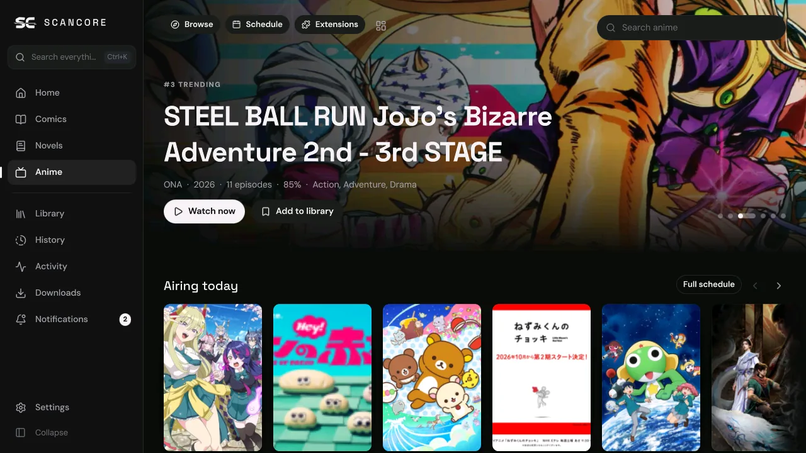
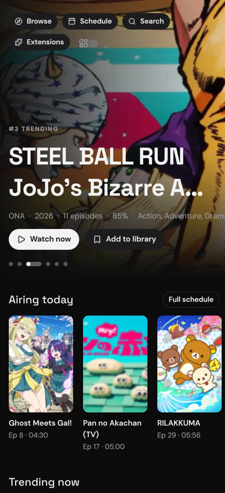
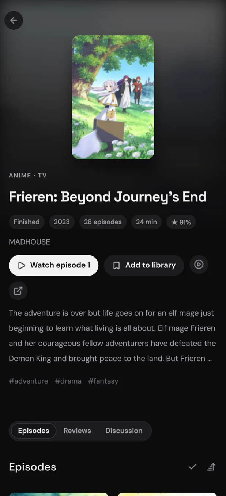
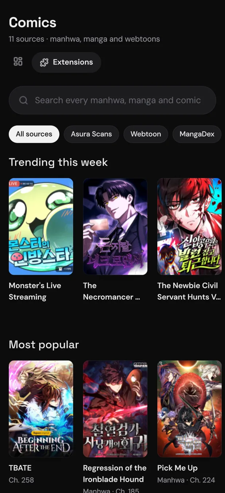
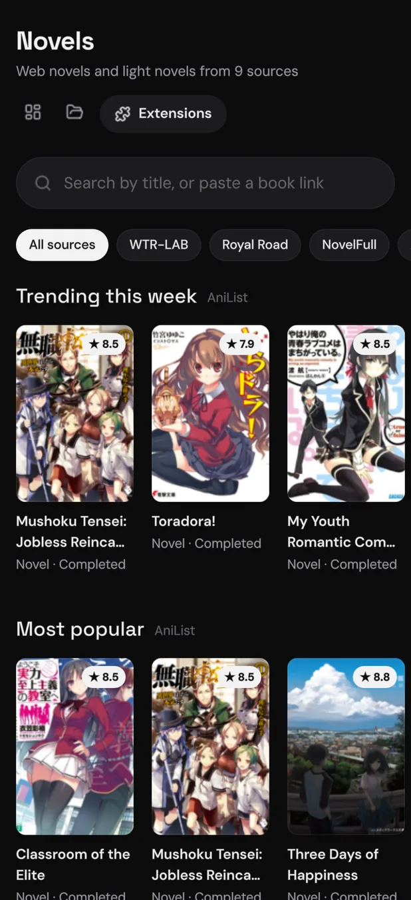
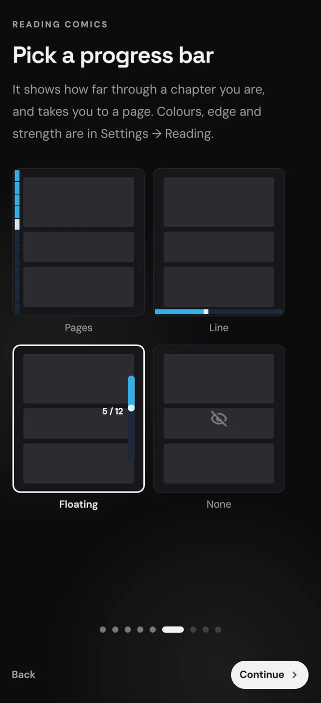

# SCANCORE

### Comics, novels and anime in one app
Read and watch from the sources you choose, on your phone and your computer.

## Download

**Android** 9+ · **Windows** 10/11 · **macOS** 13+ · **Linux** (AppImage, Flatpak)

*Only download SCANCORE from this repository's [releases](https://github.com/medium-gh/scancore/releases).*

 

  

## Features

* Comics, novels and anime share one library, one history and one search.
* Runs the extensions you already use: Mihon and Tachiyomi for comics, Aniyomi for anime, LNReader plugins for novels.
* Coming from Mihon or Komikku? Import a backup with your categories and progress, and point SCANCORE at your downloads to read them where they are.
* A comic reader for strips and pages, and a novel reader with your choice of type, spacing and theme.
* Its own video player, with resume, intro skipping, quality and dub choices, and gestures on phones.
* Trackers: AniList, MyAnimeList, Kitsu, MangaUpdates, Shikimori, Bangumi and Comick.
* Downloads for reading and watching offline, and notifications for new chapters.
* Optional sync between your devices, through scancore.onl, WebDAV or a folder.
* Themes, layouts and shortcuts you can change, in 19 languages.

## Questions and help

[Discord](https://scancore.onl/discord) for questions and chat · [Issues](https://github.com/medium-gh/scancore/issues) for bugs and ideas · [Changelog](CHANGELOG.md)

Installing

* **Android:** open the APK and allow installs from your browser when asked. Older 32-bit phones take the `armv7` APK. Updates are offered inside the app.
* **Windows:** if SmartScreen warns about an unknown app, choose *More info*, then *Run anyway*.
* **macOS:** the app is not notarised yet, so the first time, right-click it and choose *Open*.
* **Linux:** make the AppImage executable (it needs FUSE 2), or install the `.flatpak` with `flatpak install --user`. [AUR, Homebrew, Scoop and WinGet](docs/package-managers.md) packages are kept by the community.

## Contributing

Pull requests are welcome. For bigger changes, open an issue first so we can talk it through. Building, tests and where code goes are in [CONTRIBUTING.md](CONTRIBUTING.md).

### Disclaimer

SCANCORE hosts no content and is not affiliated with any site or extension. Extensions are other people's code, and you choose which to run. Rights holders, see [TAKEDOWN.md](TAKEDOWN.md). Please support the creators of the series you enjoy.

### License

[MIT](LICENSE) © Medium Dev. Fonts, icons and libraries keep their own licences: see Settings → About → Licences and [host/NOTICE.md](host/NOTICE.md).

